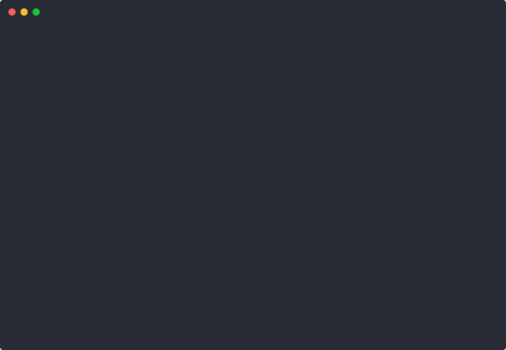

# EcoOptimize

Plateforme IoT distribuée pour la surveillance et l'optimisation en temps réel de la production et de la consommation d'énergie verte à partir d'un réseau de capteurs connectés.

## Démo

[](demo/demo.svg)

Le tableau de bord (`scripts/watch.py`) interroge l'API en direct : production et consommation totales, état de chaque nœud, alertes de surcharge et suggestions de répartition entre nœuds.

## Architecture

```
[simulateur Python] --MQTT--> [broker Mosquitto] --MQTT--> [backend Node.js]
     (4 nœuds simulés,                                          |
      pannes/pics aléatoires)                          stocke dans MySQL
                                                                   |
                                                          détecte les surcharges
                                                          et propose une répartition
                                                          (src/optimizer.js)
                                                                   |
                                                           expose une API REST
                                                              /       \
                                                  scripts/watch.py   app Flutter
                                                  (terminal, démo)   (mobile)
```

| Dossier | Rôle |
| --- | --- |
| `simulator/` | Simule plusieurs nœuds (sites de production/consommation d'énergie) et publie des mesures périodiques via MQTT, avec pannes et pics de charge aléatoires |
| `broker/` | Configuration Mosquitto (broker MQTT, utilisé par Docker) |
| `backend/` | Microservice Node.js : ingestion MQTT, persistance MySQL, détection de surcharge et suggestions de répartition, API REST |
| `docker-compose.yml` | Orchestration complète (broker, MySQL, backend, simulateur) |
| `scripts/` | Outils de développement : lancer la stack sans Docker, afficher les données en direct |
| `demo/` | Enregistrement de démonstration (asciicast et SVG animé) |

L'application mobile Flutter (tableau de bord et historique par nœud) qui consomme cette API se trouve dans un dépôt séparé : `ecooptimize_mobile`.

## Logique de décision

Pour chaque nœud en ligne, le backend calcule le bilan `production − consommation` :

- bilan inférieur à −2 kW : alerte de **surcharge** ;
- bilan supérieur à +2 kW : le nœud est excédentaire ;
- nœud qui ne répond plus : alerte `node_offline`.

Chaque nœud en déficit se voit suggérer, par appariement glouton, le nœud excédentaire disposant de la plus grande marge (`src/optimizer.js`).

## API REST

| Route | Description |
| --- | --- |
| `GET /health` | État du service (connexion MQTT, base de données) |
| `GET /api/nodes` | Dernier état connu de chaque nœud |
| `GET /api/nodes/:id/history?limit=100` | Historique d'un nœud |
| `GET /api/alerts` | Alertes récentes (surcharge, nœud hors ligne) |
| `GET /api/summary` | Production/consommation totales + suggestions de répartition entre nœuds |

## Lancer le projet

### Avec Docker (stack complète : Mosquitto + MySQL)

```bash
docker compose up --build
curl http://localhost:4000/api/summary
```

### Sans Docker (développement rapide)

Un broker MQTT embarqué et un stockage en mémoire, pour itérer vite sans dépendance externe :

```bash
./scripts/dev_up.sh      # démarre broker + backend + simulateur
./scripts/watch.py       # tableau de bord en direct dans le terminal
./scripts/dev_down.sh    # arrête tout
```

## Résilience

- **Pannes de nœuds** : le simulateur met aléatoirement des nœuds hors ligne ; le backend le détecte et le signale (`node_offline`) sans s'arrêter.
- **Anti-répétition des alertes** : une alerte n'est enregistrée qu'au changement d'état (par exemple le passage en surcharge), pas à chaque message MQTT.
- **Résilience côté client** : `/api/summary`, `/api/nodes` et `/api/alerts` sont interrogés indépendamment ; l'échec d'un seul endpoint n'empêche pas d'afficher les autres.

## Reproduire la démo

```bash
pip install asciinema
./scripts/dev_up.sh
asciinema rec -c "python3 scripts/watch.py --interval 3 --duration 20" demo/demo.cast
npx svg-term-cli --in demo/demo.cast --out demo/demo.svg --window --no-cursor
```
